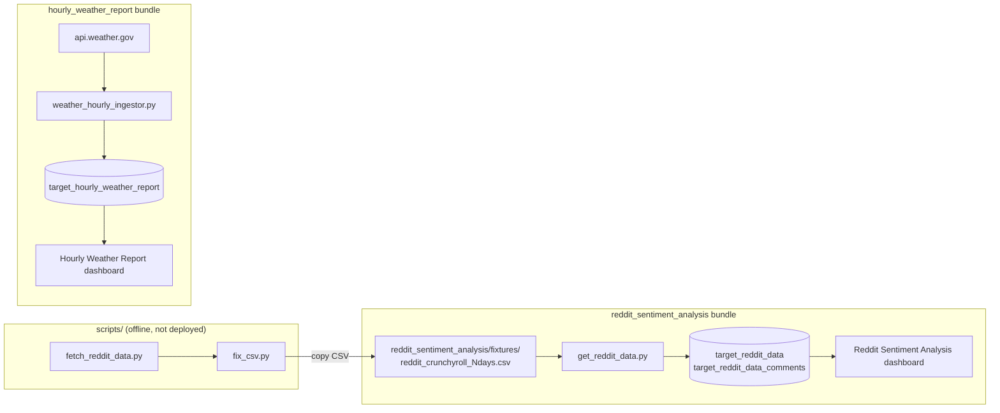
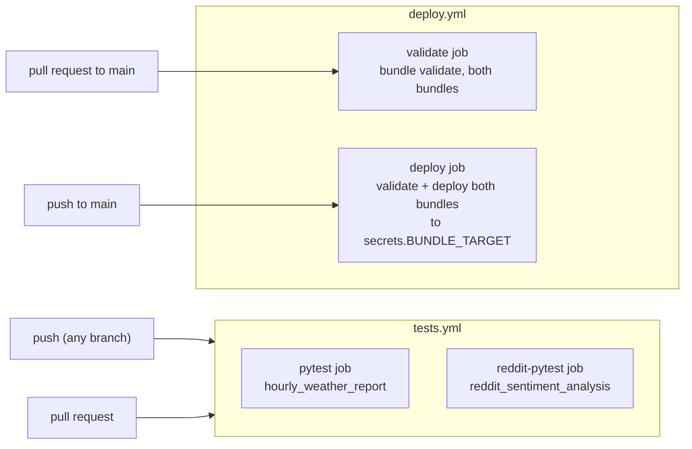

# Data Foundary

A collection of small, end-to-end data engineering projects built on **Databricks**. Each project pulls data from a public source, cleans it, stores it in **Delta Lake** tables, and refreshes a **Lakeview dashboard** on a schedule. Every project is packaged as its own [Databricks Asset Bundle](https://docs.databricks.com/dev-tools/bundles/index.html) and is deployed through GitHub Actions.

## Projects

| Project | Source | Schedule | Output |
|---|---|---|---|
| [`hourly_weather_report`](hourly_weather_report/README.md) | NOAA API (`api.weather.gov`): latest observations for KJFK, KSFO and KDFW | Hourly, on the hour (America/Mexico_City) | `<target>_hourly_weather_report` Delta table and the *Hourly Weather Report* dashboard |
| [`reddit_sentiment_analysis`](reddit_sentiment_analysis/README.md) | r/Crunchyroll posts and comments, already scored for sentiment and classified, from a fixture CSV | Daily at 09:00 (America/Mexico_City) | `<target>_reddit_data` and `<target>_reddit_data_comments` Delta tables and the *Reddit Sentiment Analysis* dashboard |

### hourly_weather_report
Fetches the latest NOAA observation for each configured station, flattens it into one row per station, and writes it to Delta. Reruns are idempotent: rows with the same station and observation timestamp are replaced, so no duplicates build up. To add a station, add it to `WEATHER_STATION_IDS` in `src/constants/weather_constants.py`.

### reddit_sentiment_analysis
Loads Reddit post data with Spark and normalizes it: types, booleans, timestamps, HTML entities and nulls. Each post carries its comments as nested JSON, and the pipeline flattens these into a separate table that keeps the parent/child links. Both tables are upserted with `MERGE INTO`, so reruns update existing rows and add new ones.

The input CSV is produced offline by the helper scripts in [`scripts/`](scripts/):
- `fetch_reddit_data.py` scrapes the subreddit and scores sentiment with a HuggingFace transformer (`spacesedan/reddit-sentiment-analysis-longformer`). It also uses local Ollama models to summarize each post (`llama3.2:1b`) and to classify its `device` and `issue_type` (`deepseek-r1:8b`). The output is `reddit_crunchyroll_<DAYS_BACK>days.csv`.
- `fix_csv.py` checks those classifications against each post's Reddit flair and corrects them (`--fix`, `--stats`). The file it reads is set by the hardcoded `CSV_FILE` constant.

Copy the finished CSV into `reddit_sentiment_analysis/fixtures/`, where the pipeline finds any file matching `reddit_crunchyroll_<N>days.csv`. Its columns must match `SCHEMA` in `src/get_reddit_data.py`.

## Repository overview



`target` is the bundle target (`dev` or `prod`), and every table lives in `workspace.default`.

## How each pipeline runs

```
 source data ──► Spark Python task (serverless) ──► Delta table(s) ──► dashboard refresh task
```

Each bundle's `resources/` folder defines:
- a two-task job: the ETL script, then a refresh of the dashboard,
- the dashboard resource and its `.lvdash.json` definition.

Tables are prefixed with the deployment target (`dev_` or `prod_`). This keeps dev and prod data separate inside `workspace.default`. The `dev` target is the default: it deploys in development mode, which prefixes resource names and keeps the job schedule paused. The `prod` target unpauses the schedule.

Known issue: both dashboard definitions query the `prod_` tables, whichever target they are deployed to. A dev deployment writes to `dev_` tables, but its dashboard still shows prod data.

## Tech stack

Python · pandas · PySpark · Delta Lake · Databricks Asset Bundles · Lakeview dashboards · pytest · uv · GitHub Actions

## Getting started

Prerequisites: Python 3.10–3.12, [uv](https://docs.astral.sh/uv/), and the [Databricks CLI](https://docs.databricks.com/dev-tools/cli/index.html) configured with `databricks configure`.

Every project is self-contained, so run all commands from inside its folder:

```bash
# Weather
cd hourly_weather_report
uv sync --dev
uv run pytest

# Reddit (the tests start a local Spark + Delta session and need Java)
cd reddit_sentiment_analysis
UV_PROJECT_ENVIRONMENT=.venv-test uv run --no-default-groups --group test pytest
```

The Reddit tests use the `test` dependency group (OSS `pyspark` 3.5 and `delta-spark` 3.3). That group conflicts with the `dev` group (`databricks-connect`), because both install into the same `pyspark/` package directory. Keep the test group in its own virtualenv (`.venv-test/`, which is gitignored) so it does not break `.venv`. See [`reddit_sentiment_analysis/README.md`](reddit_sentiment_analysis/README.md#run-tests) for details.

Deploy a bundle:

```bash
databricks bundle validate
databricks bundle deploy --target dev    # default: resource names prefixed, schedules paused
databricks bundle deploy --target prod   # schedule unpaused
```

## CI/CD



- **Tests** (`.github/workflows/tests.yml`) run on every push and pull request, with two jobs:
  - `pytest`: `hourly_weather_report` on Python 3.11, installing `requirements.txt` with pip.
  - `reddit-pytest`: `reddit_sentiment_analysis` with Java 17 (Temurin), uv and Python 3.11, running `uv run --locked --no-default-groups --group test pytest`.
- **Deploy** (`.github/workflows/deploy.yml`): pull requests to `main` validate both bundles. A push to `main` validates and deploys both bundles to the target set in the `BUNDLE_TARGET` secret. The workflow needs the `DATABRICKS_HOST` and `DATABRICKS_TOKEN` secrets.

The two workflows are independent: the deploy does not wait for the tests to pass.

## Repository structure

```
data-foundary/
├── hourly_weather_report/      # NOAA weather ETL bundle
├── reddit_sentiment_analysis/  # Reddit sentiment ETL bundle (input CSV in fixtures/)
├── scripts/                    # Offline tools that build the Reddit fixture CSV
├── .github/workflows/          # Test and deploy pipelines
├── .claude/agents/             # Claude Code subagents (reviewers, test writer, scaffolder, docs)
└── CLAUDE.md                   # Guidance for Claude Code
```
