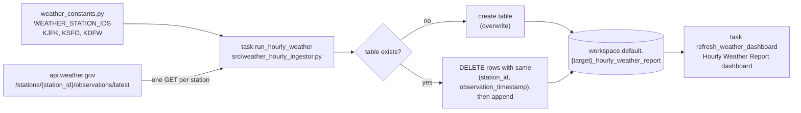

# Hourly Weather ETL Project

An end-to-end data engineering project that ingests hourly NOAA weather observations, stores them in Delta Lake on Databricks, and refreshes a dashboard on a schedule. The pipeline is designed to be small, readable, and easy to extend with new weather stations.

## Highlights

- Multi-station ingestion (KJFK, KSFO, KDFW) with a simple list-based config
- Delta Lake writes with idempotent updates per station/timestamp
- Automated Databricks job + dashboard refresh
- Unit tests for core ingestion logic

## Architecture

1. Fetch latest observations from NOAA for each configured station.
2. Normalize the response into a single-row schema.
3. Write into a Delta table in Databricks.
4. Refresh the dashboard after each run.



The job (`hourly-weather-report`, defined in `resources/weather_job.yml`) runs every hour on the hour (`0 0 * * * ?`, America/Mexico_City). Its first task is a serverless `spark_python_task` that calls `src/weather_hourly_ingestor.py` with `--table-name workspace.default.${bundle.target}_hourly_weather_report`. The dashboard refresh task runs after it.

## Tech stack

- Python + pandas
- Databricks + Delta Lake
- Databricks Asset Bundles
- pytest

## Project layout

- `src/weather_hourly_ingestor.py` ETL logic
- `src/constants/weather_constants.py` configuration
- `resources/weather_job.yml` job scheduling
- `resources/weather_dashboard.yml` dashboard resource
- `resources/weather_dashboard.lvdash.json` dashboard definition
- `tests/test_weather_hourly_ingestor.py` tests
- `pytest.ini` sets `pythonpath = .`, so the tests import `from src import weather_hourly_ingestor`
- `requirements.txt` the dependencies CI installs (`pandas`, `requests`, `pytest>=9.2,<10`)

## Run locally

```bash
uv sync --dev
uv run pytest
```

CI installs `requirements.txt` with pip instead of using uv:

```bash
python -m pip install -r requirements.txt
python -m pytest
```

The tests do not need Spark. They register `MagicMock` stubs for `pyspark` in `sys.modules` (with `setdefault`, so the stubs only apply when pyspark is not installed, as in CI), and a `_patch_spark` helper patches the module-level `SparkSession` name. Patch that name rather than attributes of the shared mock: pytest 9.2+ undoes `monkeypatch.setattr` on a mock child with `delattr`, which removes the attribute permanently and breaks later tests.

## Deploy to Databricks

```bash
databricks configure
databricks bundle validate
databricks bundle deploy --target dev
databricks bundle deploy --target prod
```

### Targets

| | `dev` (default) | `prod` |
|---|---|---|
| Mode | `development` | `production` |
| Table | `workspace.default.dev_hourly_weather_report` | `workspace.default.prod_hourly_weather_report` |
| Job schedule | Paused | Unpaused (`pause_status: UNPAUSED` override) |
| Resource names | Prefixed with `[dev <your user name>]` | Not prefixed |
| Permissions | Bundle defaults | `users` group gets `CAN_MANAGE` |

Both targets deploy to `/Workspace/Users/<current user>/GitHub Repository Bundles/hourly_weather_report/<target>`.

Known issue: `resources/weather_dashboard.lvdash.json` queries `workspace.default.prod_hourly_weather_report` directly. A dev deployment writes to the `dev_` table, but its dashboard still shows prod data.

## Configuration

- Add stations in `src/constants/weather_constants.py` via `WEATHER_STATION_IDS`.
- On Databricks, the table name comes from the `--table-name` parameter in `resources/weather_job.yml`. `WEATHER_TABLE_NAME` is only the default used when `--table-name` is not passed. It can be set through the `WEATHER_TABLE_NAME` environment variable, or built from `WEATHER_TABLE_CATALOG`, `WEATHER_TABLE_SCHEMA` and `BUNDLE_TARGET` (defaults: `workspace.default.dev_hourly_weather_report`).
- Adjust schedule in `resources/weather_job.yml`. If you rename the table, also update the query in `resources/weather_dashboard.lvdash.json`.

## Results

The pipeline produces a Delta table with station metadata, observation timestamps, and weather metrics, which powers the dashboard for quick hourly insights.

## Next ideas

- Add more stations or regions
- Backfill historical observations
- Add data quality checks
