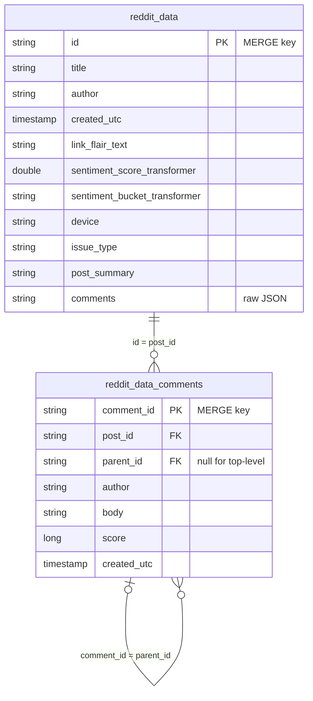
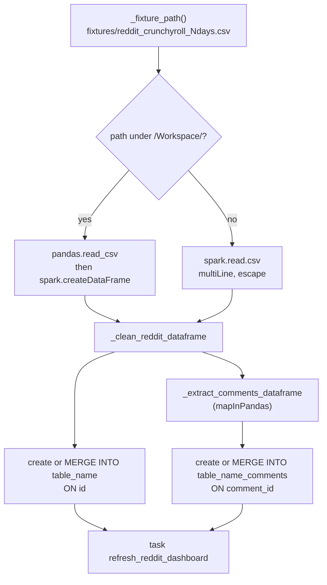
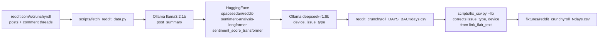

# Reddit Sentiment Analysis

A Databricks ETL project that loads Reddit post data (and nested comments) from a fixture CSV, cleans and normalizes the records with Spark, and writes the results to Delta tables for analytics and dashboard reporting.

## What this project does

- Loads Reddit post data from a local fixture file in `fixtures/`
- Cleans and normalizes post fields (types, booleans, timestamps, HTML entities, nulls)
- Parses and flattens nested comments into a separate comments table
- Upserts both posts and comments into Delta tables in Databricks
- Refreshes a Databricks dashboard after the ETL task completes (via job workflow)

## Data outputs

The pipeline writes two Delta tables using the base table name you pass:

- `<table_name>`: cleaned Reddit post records
- `<table_name>_comments`: flattened comment records with `post_id` and `parent_id`

The ETL uses merge/upsert behavior so reruns update existing rows and insert new rows. Rows that are no longer in the source are kept.



The posts table has more columns than shown here; `SCHEMA` in `src/get_reddit_data.py` lists them all. The keys are logical only: Delta enforces no constraints.

## How the pipeline works

1. Find a fixture file in `fixtures/` matching `reddit_crunchyroll_<days>days.csv`
2. Load the file into Spark
3. Clean and normalize post fields
4. Parse and flatten JSON comments into rows
5. Write/merge posts and comments into Delta tables



- Both table names are checked by `_validate_table_name` before Spark starts, because they are interpolated into SQL.
- Spark can't read workspace files directly, so on Databricks (where the bundle deploys the fixture under `/Workspace/`) the CSV is read with pandas. Locally, Spark reads it with `multiLine=True, escape='"'`, because fields contain embedded newlines and doubled quotes.
- Comments arrive as a JSON string column of nested `replies`. They are flattened with `mapInPandas` for Databricks Serverless compatibility. Top-level comments get a null `parent_id`; replies point at their parent's `comment_id`.
- Each table is created on the first run and merged into afterwards. Posts are written before comments are extracted.

The job (`reddit-sentiment-analysis-daily`, defined in `resources/reddit_job.yml`) runs daily at 09:00 (`0 0 9 * * ?`, America/Mexico_City). Its first task is a serverless `spark_python_task` that calls `src/get_reddit_data.py` with `--table-name workspace.default.${bundle.target}_reddit_data`. The dashboard refresh task runs after it.

## Where the fixture comes from

The fixture CSV is built offline by the scripts in [`../scripts/`](../scripts/). They are not deployed.



- `fetch_reddit_data.py` writes `reddit_crunchyroll_<DAYS_BACK>days.csv`. `DAYS_BACK` is a constant in the script.
- `fix_csv.py` reads the file named by its hardcoded `CSV_FILE` constant. Without flags it only reports problems. `--fix` writes the corrections and `--stats` prints flair statistics.
- Copy the result into `fixtures/`. Its columns must match `SCHEMA` in `src/get_reddit_data.py`.

## Project structure

- `src/get_reddit_data.py` - main ETL script (CLI entrypoint for Databricks job)
- `fixtures/` - source CSV fixture(s) used by the ETL
- `resources/reddit_job.yml` - Databricks job definition (ETL + dashboard refresh)
- `resources/reddit_dashboard.yml` - dashboard resource config
- `resources/reddit_analysis.lvdash.json` - dashboard definition
- `tests/conftest.py` - session-scoped local Spark fixture (with Delta when `delta-spark` is installed)
- `tests/test_get_reddit_data.py` - tests for fixture loading, cleaning, comment flattening, table name validation and Delta create/merge
- `databricks.yml` - Databricks Asset Bundle configuration

## Running locally (development)

This project is primarily designed to run on Databricks. The unit tests can be run locally, and the full ETL can be run locally only if your environment supports Spark + Delta.

`pyproject.toml` defines two dependency groups that cannot be installed together (`[tool.uv] conflicts`):

| Group | Contents | Used for |
|---|---|---|
| `dev` (uv default) | `pytest`, `databricks-connect>=15.4,<15.5` | Working against a Databricks workspace |
| `test` | `pyspark==3.5.*`, `delta-spark==3.3.*`, `pandas`, `pyarrow`, `pytest`, `setuptools` | Running the tests on local Spark |

### Install dev dependencies

```bash
cd reddit_sentiment_analysis
uv sync --dev
```

### Run tests

The tests need Java (CI uses Java 17). Run them from the `test` group in a separate virtualenv:

```bash
cd reddit_sentiment_analysis
UV_PROJECT_ENVIRONMENT=.venv-test uv run --no-default-groups --group test pytest
```

- Use a separate virtualenv (`.venv-test/`, gitignored). `databricks-connect` and OSS `pyspark` both install into `pyspark/`, so switching groups inside the same `.venv` corrupts it.
- `[tool.pytest.ini_options]` sets `pythonpath = ["src"]` and `testpaths = ["tests"]`, so no `PYTHONPATH` is needed.
- The first run downloads the Delta jars from Maven. The full suite takes a few minutes.
- `conftest.py` starts a `local[1]` session in UTC with a temporary warehouse, and enables Delta when `delta-spark` is installed. The Delta create/merge tests are skipped without it. The fixture also ships `src/get_reddit_data.py` to the Python workers with `addPyFile`, because `mapInPandas` workers don't inherit pytest's `pythonpath`.
- The tests read the real CSV in `fixtures/`.
- `test_validate_table_name_rejects_trailing_newline` guards against names with a trailing newline (`_validate_table_name` uses `fullmatch`).

CI runs the same suite with `uv run --locked --no-default-groups --group test pytest` (job `reddit-pytest` in `.github/workflows/tests.yml`).

### Run the ETL script manually (Spark/Delta environment required)

```bash
cd reddit_sentiment_analysis
uv run python src/get_reddit_data.py --table-name workspace.default.dev_reddit_data
```

`--table-name` is required; the script raises an error without it.

## Deploy to Databricks (Asset Bundle)

```bash
cd reddit_sentiment_analysis
databricks bundle validate
databricks bundle deploy --target dev
databricks bundle deploy --target prod
```

The job definition in `resources/reddit_job.yml` runs the ETL task and then refreshes the dashboard.

### Targets

| | `dev` (default) | `prod` |
|---|---|---|
| Mode | `development` | `production` |
| Tables | `workspace.default.dev_reddit_data`, `workspace.default.dev_reddit_data_comments` | `workspace.default.prod_reddit_data`, `workspace.default.prod_reddit_data_comments` |
| Job schedule | Paused | Unpaused (`pause_status: UNPAUSED` override) |
| Resource names | Prefixed with `[dev <your user name>]` | Not prefixed |
| Permissions | Bundle defaults | `users` group gets `CAN_MANAGE` |

Both targets deploy to `/Workspace/Users/<current user>/GitHub Repository Bundles/reddit_sentiment_analysis/<target>`.

Known issue: `resources/reddit_analysis.lvdash.json` queries `prod_reddit_data` and `prod_reddit_data_comments` (unqualified names) in both targets. A dev deployment writes to the `dev_` tables, but its dashboard still shows prod data. If you rename a table, update the dashboard queries too.

## Notes

- The input fixture currently represents Reddit data for the Crunchyroll subreddit (based on the fixture filename pattern).
- Helper scripts for collecting and cleaning Reddit CSV data live in the repo root under `../scripts/`.
